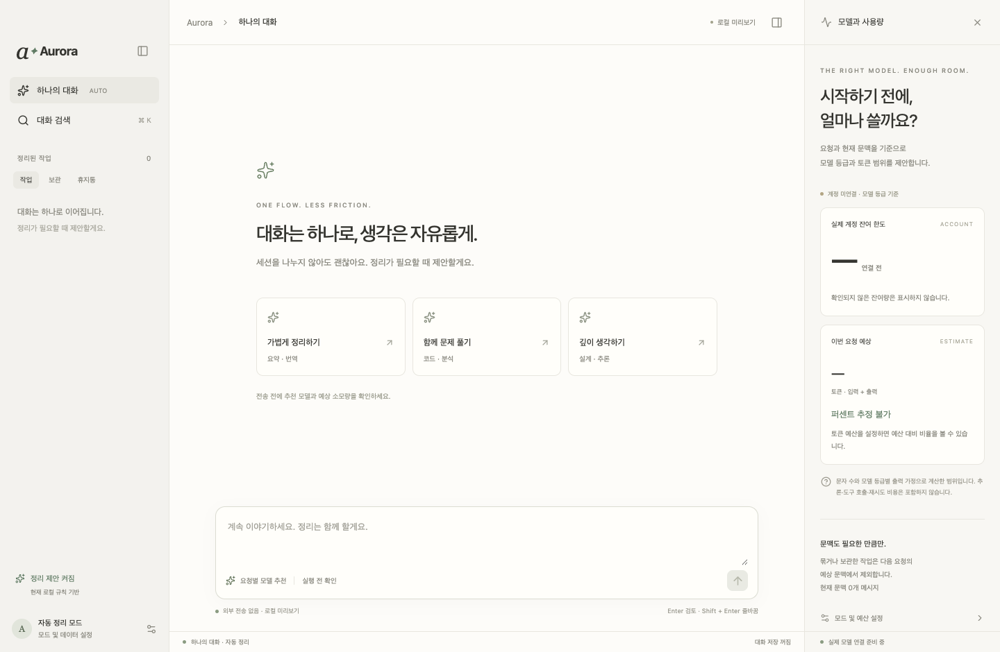

# Aurora

**A desktop app for using several AI providers in one window and splitting work between an expensive model and cheap ones.**

It calls OpenAI, Anthropic, Gemini and Ollama models from one app. Before a request runs, an analyzer model suggests a model and the app shows an estimated token range, but you choose the model that runs. In team mode a lead model (Claude Opus 5.5 by default, which needs a paid API key) splits the work and judges the results, and a worker model (Gemini Flash's free tier or a local Ollama model) does the tasks.

There is no automatic router that picks a model for you yet. A setup that answers with free models only was tested by [measurement scripts](bench/README.md) outside the app.

[English](README.en.md) · [한국어](README.md) · [Web demo](https://aurora-two-virid.vercel.app/) · [English overview](https://aurora-two-virid.vercel.app/en/) · [Documentation](docs/README.md) · [Components](docs/components.md)

Developer preview · [MIT](LICENSE) · macOS / Windows



## Try the demo

[Open the browser demo](https://aurora-two-virid.vercel.app/) to explore conversation organization, model comparison and token ranges without installation. It runs locally without calling an AI provider. The interactive interface is currently in Korean; the [English overview](https://aurora-two-virid.vercel.app/en/) explains the features and limitations.

Provider connections and real text responses are available in the installed desktop app. The public 0.1.4 preview requires an explicit analysis action and manual execution-model selection, and adds a team mode in which a lead model plans and reviews while a cheaper worker model does the work. Team mode has not yet been verified against live providers.

## Download · 0.1.4

| Platform | Installer |
| --- | --- |
| macOS · Apple Silicon | [DMG](https://github.com/uiwwsw/aurora/releases/download/v0.1.4/Aurora-0.1.4-mac-arm64.dmg) |
| macOS · Intel | [DMG](https://github.com/uiwwsw/aurora/releases/download/v0.1.4/Aurora-0.1.4-mac-x64.dmg) |
| Windows · x64 | [EXE](https://github.com/uiwwsw/aurora/releases/download/v0.1.4/Aurora-0.1.4-windows-x64.exe) |

[ZIP files, changelog, checksums and signing information](https://github.com/uiwwsw/aurora/releases/tag/v0.1.4)

On macOS, open the DMG and move Aurora to Applications. On Windows, run the installer. End users do not need Node.js. The macOS 0.1.4 packages use Developer ID signing and Apple notarization. The Windows installer is also unsigned by a developer certificate. Operating-system security prompts or execution restrictions may appear.

## Features

- **One conversation, organized work:** group messages, archive work, move it to trash and restore it. Legacy mode provides manually managed sessions.
- **Separate model roles:** configure an internal analyzer and a default executor independently, then choose an execution model per request.
- **Review before execution:** compare estimated input and output tokens, including active context, against a planning budget you set.
- **Observed usage:** display the provider's actual input and output usage separately from estimates.
- **Local workspace controls:** search, optional conversation persistence, and light and dark themes.
- **Updates:** Windows checks at startup and every six hours, then downloads new versions in the background.

Organization suggestions use local rules. Recommendations and execution are separate actions. Only text responses are supported; filesystem editing and shell execution are unavailable.

## Team mode (0.1.4)

The expensive model only splits and reviews the work; cheap models do it. This is the orchestrator-workers pattern Anthropic describes in [Building effective agents](https://www.anthropic.com/engineering/building-effective-agents).

1. When a request comes in, the **lead model** divides it into 1–6 tasks that a junior developer could finish alone.
2. A **junior model** (Gemini Flash free tier, Ollama local, etc.) receives one task at a time and never sees the whole conversation.
3. The lead only judges the results and sends back the tasks that fall short, with feedback. After at most two rounds a worker merges the results into one answer. The lead does not rewrite the final answer.

Turn on team mode in Settings and choose the lead and worker models. Real API usage must be enabled. The default lead is Claude Opus 5.5 (`ANTHROPIC_API_KEY`); with the OpenAI preset it is GPT-6 Astra (`OPENAI_API_KEY`). Lead calls (one plan, plus one review per round) are billed to that account. Set `GEMINI_API_KEY` for Gemini workers and `OLLAMA_MODEL` (default `qwen3`) for Ollama. You can pick a free model as the lead too, but that combination has not been measured.

### Measurement outside the app (2026-11-25)

This measurement was run via the `bench/` scripts, not the app's team mode. The scripts used a local [OmniRoute](https://github.com/diegosouzapw/OmniRoute) (an open-source gateway that puts free providers behind one address) so that three free models answered and one merged the answers, with a Wikipedia search step and a number check added. Several models answering and one merging is the same structure as [Mixture-of-Agents](https://github.com/togethercomputer/MoA).

On the same 31 questions the free bundle averaged 8.23 and ChatGPT's free tier (one day's answers, without logging in) 8.19, which is no real difference; code and document tasks were also tied. Responses were 3–4x slower, about 38 seconds at the median. One grader (Claude) scored blind to the source, and with so few questions a 0.04-point gap is within the error. This setup is not in the app. Methods and limits are in the [measurement notes](bench/README.md).

## Estimates and data

Token ranges use **character counts and tier-level output assumptions**. They are not per-model empirical predictions or guaranteed costs; models in the same tier show the same range. Budget percentages refer to the planning budget you enter, not an account's remaining quota.

Generation limits are 2,048 tokens for internal analysis and 4,096 for execution. Input and analysis usage are separate. These are per-call limits, not whole-task budget enforcement. A response can be incomplete when it reaches the output limit. A fixed token amount does not guarantee completion.

The browser preview does not send conversations to AI providers. When you execute a provider call in the desktop app, the request and selected context are sent to that provider. Conversation persistence is off by default. Enabling it stores data on the current device; it is not an encrypted vault. Disabling persistence removes the stored copy while keeping the current window's conversation.

See the [configuration guide](docs/configuration.md) for generic provider setup.

## App updates

From 0.1.2, Windows downloads new releases and offers a restart. You can restart now or install on a normal quit. **Help → 업데이트 확인… (Check for updates)** also checks manually. Review unsaved conversations and drafts before restarting.

macOS updating requires Developer ID signing. Older ad-hoc previews must be replaced once with a signed installer. Versions 0.1.1 and earlier have no updater and require a manual replacement. Real cross-version automatic installation still needs separate validation.

## Run from source

Use Node.js 24 or newer.

```bash
git clone https://github.com/uiwwsw/aurora.git
cd aurora
npm ci
npm start
```

| Command | Purpose |
| --- | --- |
| `npm run build` | Type-check and build the desktop frontend |
| `npm run build:web` | Generate the Korean demo, English overview and search metadata |
| `npm test` | Validate domain logic, provider adapters, updater behavior and web generation |
| `npm run test:desktop` | Exercise Electron UI in an isolated QA profile |
| `npm run package:mac` | Build macOS DMG and ZIP files |
| `npm run package:win` | Build a Windows x64 installer on Windows |

Provider tests use mocked responses. Live provider behavior, whole-task cost enforcement and recommendation quality require separate evaluation. Follow the repository's `AGENTS.md` and execution wrapper for local development.

## Releases and documentation

Releases use a verified source commit, platform packaging and installed-app launch checks. macOS publication requires both architectures to be Developer ID signed and notarized; tags and ordinary pushes do not automatically access signing credentials. Vercel deploys the web preview from main; preview deployments exclude search indexing.

- [Documentation index](docs/README.md)
- [Release, signing and update guide](docs/releases.md) — Korean
- [Configuration](docs/configuration.md)
- [Components and borrowed ideas](docs/components.md) — Korean
- [Product vision and execution budgets](docs/product-vision.md) — Korean
- [Web search architecture](docs/seo.md)
- [Contributing](CONTRIBUTING.md) · [Issues](https://github.com/uiwwsw/aurora/issues)

Code is licensed under [MIT](LICENSE). The SUITE font has a [separate license](public/fonts/LICENSE).
