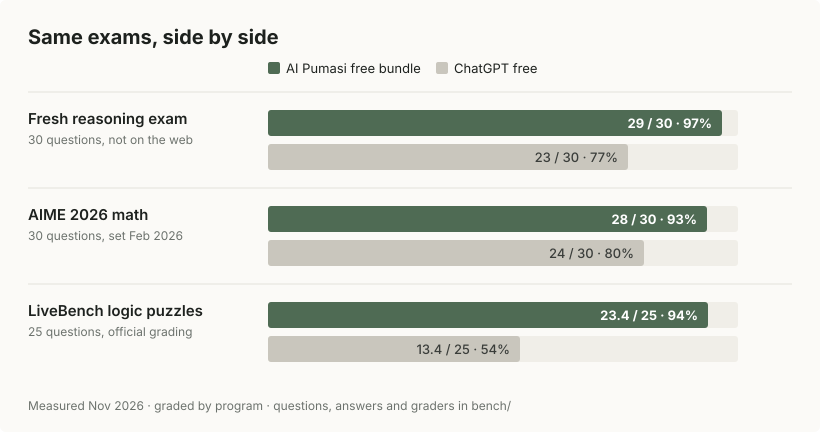
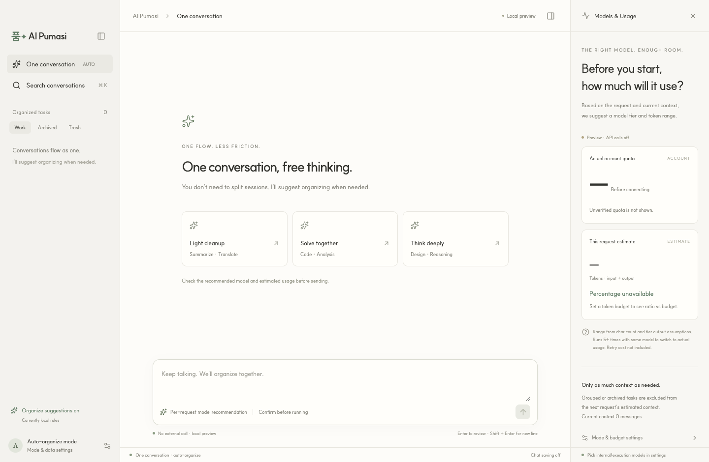

<h1>AI Pumasi · AI품앗이</h1>

A desktop app where several free AI models work on your question together and vote on the answer

<i>Pumasi</i> (품앗이) is the Korean tradition of neighbours taking turns to help with each other's work. Called Aurora up to 0.1.8.

<a href="https://ai-pumasi.vercel.app/">Web demo</a> · <a href="#install">Download</a> · <a href="docs/guide.en.md">Guide</a> · <a href="docs/components.md">Components</a> · <a href="bench/README.md">Measurements</a> · <a href="CHANGELOG.md">Changelog</a> · <a href="README.md">한국어</a>

## What AI Pumasi does well

**Free models already beat ChatGPT's free tier.** On a freshly generated 30-question reasoning exam that is not on the internet, the free model Nemotron Super scored 30 and ChatGPT free 23; answers are computed by a program and graded automatically. A public exam agrees: on AIME 2026 Super solved 28 of 30 and ChatGPT free 24. AI Pumasi's bundle vote asks several free models the same question and weights each by its measured skill, so you get the best model's level without knowing which model that is (55 public questions: bundle 51.4, best single model 51.0). Beating the best single model by bundling is not proven yet; that experiment is under way. Method and raw data are in the [measurement notes](bench/README.md).

**The expensive model only gets the expensive work.** In team mode the lead model (for example Claude Opus) splits the request into 1–6 tasks and decides whether to approve the results. It never rewrites the answer; a free worker model merges the results. The priciest output tokens stay small by design.

**When a free model stalls or cuts corners, AI Pumasi hands the task out again.** Empty, too-short or cut-off replies and timeouts count as failures: the same model gets one more try, then another free model takes over. Models that fail often or run slow are recorded and moved down the list. The run screen shows which task has been running for how many seconds.

**You see the cost before you spend it.** An estimated token range and its share of your budget before a run; lead and worker usage shown separately after it.

**A question app for anyone, not a coding tool.** It answers general questions and document tasks without file or terminal access. The interface is in English and Korean; it follows your system language and can be switched in Settings.

## What works now

- Text requests to OpenAI, Anthropic, Gemini and Ollama models
- Team mode: the lead splits the work, workers do it, the lead judges (up to two rounds)
- Stalled-task recovery: retries for empty or cut-off replies and timeouts, model order from each model's track record, per-task progress
- Bundle vote: 2–5 free models answer the same question and a vote weighted by measured skill picks the answer (a long answer is merged by the strongest model). Once the models still running could not change the result, it stops waiting for them
- Token estimates learned from your own usage: the next request's share of your budget, from tokens you actually used, recorded on your device (can be switched off)
- Several free hosts: add free keys from NVIDIA, OpenRouter, Groq or Google in Settings and use their free models right away. When several hosts serve the same model, a rate-limited host rests and calls move to another one automatically
- Automatic (free) model: uses the free model with the best measured score that can run now, and moves to the next when it is out
- Any other OpenAI-compatible server can be added in Settings too
- API keys in Settings: encrypted with the OS keychain, never shown again, never sent to a model or written to a log
- Provider-reported usage after each request
- Conversations grouped into work items; archive, trash, restore; on-device saving (off by default)
- macOS (signed and notarized) and Windows x64 installers; automatic updates

## Coming next

Built in this order, each shipped in its own release.

1. **Pumasi board:** post a problem and your app splits it into tasks; when other users press "Help", their app processes one task automatically with their own tokens and posts the result. Results from several helpers are chosen by vote, and helping earns points. [Design](docs/pumasi-network.md) (Korean)
2. **Streaming responses:** see the answer as it is written.
3. **Automatic mode choice:** picks a single model, a team or a bundle vote for each question.
4. **File attachments.**

## Who it is for

If you need an agent that edits code and runs a terminal, [OpenCode](https://opencode.ai) or [Roo Code](https://roocode.com) fit better; if you need dozens of providers and a knowledge base, try [Cherry Studio](https://github.com/CherryHQ/cherry-studio) or [Open WebUI](https://github.com/open-webui/open-webui). AI Pumasi is for people who find one paid AI too expensive for everything and one free AI not quite enough, and who want to see what each request costs. It is a developer preview built by one person.

## Install

| Platform | Installer |
| --- | --- |
| macOS · Apple Silicon | [DMG](https://github.com/uiwwsw/ai-pumasi/releases/download/v0.1.9/AI-Pumasi-0.1.9-mac-arm64.dmg) |
| macOS · Intel | [DMG](https://github.com/uiwwsw/ai-pumasi/releases/download/v0.1.9/AI-Pumasi-0.1.9-mac-x64.dmg) |
| Windows · x64 | [EXE](https://github.com/uiwwsw/ai-pumasi/releases/download/v0.1.9/AI-Pumasi-0.1.9-windows-x64.exe) |

The Windows installer is not signed with a developer certificate, so SmartScreen may warn. Keys, team mode, data handling and running from source are covered in the [guide](docs/guide.en.md).

## License

[MIT](LICENSE). The SUITE font has a [separate license](public/fonts/LICENSE). Libraries used and projects referenced are listed in [components](docs/components.md) (Korean).
