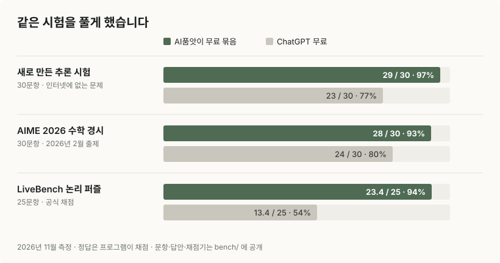

<h1>품앗이 에이전트 · Pumasi Agent</h1>

<b>무료 AI가 팀으로 일합니다.</b> 리더 모델이 일을 나누고 무료 모델이 처리합니다. 손이 더 필요하면 다른 사용자가 거들어 줍니다.

<a href="https://pumasi-agent.vercel.app/">웹 데모</a> · <a href="#설치">다운로드</a> · <a href="docs/guide.md">사용 안내</a> · <a href="docs/components.md">구성 요소</a> · <a href="bench/README.md">측정 기록</a> · <a href="CHANGELOG.md">변경 기록</a> · <a href="README.md">English</a>

## 하는 일

- **채팅과 코드, 두 모드:** 채팅은 질문과 답입니다. 코드는 Claude Code나 Codex처럼 씁니다. 프로젝트 폴더를 열고 할 일을 적으면 에이전트가 폴더를 둘러보고 파일을 직접 읽고 찾은 뒤, 고칠 내용을 diff로 보여 주고 명령을 실행하기 전에 묻습니다. 승인하기 전에는 아무것도 저장하거나 실행하지 않습니다. 코드 모드는 베타입니다.
- **일은 나누고, 돈은 아낍니다 (팀 모드):** 요청 하나를 작업 최대 6개로 나눕니다. 리더 모델이 계획하고 승인하며, 작업과 합치기는 무료 모델이 합니다. 기본 리더는 측정 성적이 가장 높은 무료 모델입니다. 한도에 걸리면 다음 순위가 이어받고, 순서는 설정에서 바꿀 수 있습니다. 리더가 결과를 확신하지 못할 때만 2등이 한 번 더 보고, 그 밖에는 호출이 늘지 않습니다. Claude Opus 같은 유료 모델을 리더로 고르면 비싼 토큰은 계획과 승인에만 씁니다.
- **키는 그대로, 손만 빌립니다 (함께하기):** 내 팀의 작업을 다른 사용자에게 맡길 수 있습니다. 그 사람의 앱이 작업 하나를 자기가 빌려주기로 한 무료 키로 처리하고 결과만 돌려줍니다. 작업 글과 결과는 두 기기 사이에서만 풀리게 암호화되어, 서버는 암호문만 나르고 돕는 사람의 화면에는 토큰 수만 보입니다. 누구의 키도 기기를 떠나지 않습니다. 도우면 점수가 쌓이고, 맡기면 점수를 씁니다. 지금은 초대 코드를 받은 사람만 가입할 수 있습니다. [설계](docs/pumasi-network.md)
- **무료 모델도 충분히 셉니다:** 여기서 쓸 수 있는 무료 모델 Nemotron 3.5 Super가 프로그램이 채점하는 시험 세 개에서 30/30, 28/30, 23/25를 받았습니다. ChatGPT 무료는 23, 24, 13.4였습니다. 문항·답안·채점기는 [측정 기록](bench/README.md)에 있습니다.
- **무료 한도가 끝나도 이어갑니다:** NVIDIA·OpenRouter·Groq·Google 무료 키를 넣으면, 자동 (무료) 모델이 쓸 수 있는 모델 중 성적이 높은 것부터 쓰고, 한도에 걸리거나 멈출 때만 다음 모델로 넘어갑니다.
- **키는 내 기기에만:** 설정에서 넣은 API 키는 OS 키체인으로 암호화해 저장하고, 다시 화면에 보여 주지 않으며, 모델 답과 오류 메시지에서도 가립니다.
- OpenAI, Anthropic, Gemini, Ollama, OpenAI 호환 서버 연결
- 실행 전 예상 토큰과 예산 대비 비율, 실행 후 실제 사용량
- 빈 답·잘린 답·시간 초과는 다시 맡기고, 그래도 안 되면 다른 모델로
- 대화 묶기·보관·휴지통, 기기 내 저장(기본 꺼짐)
- 한국어·영어 화면, macOS(서명·공증)·Windows 설치 파일, 자동 업데이트
- 업데이트 채널: 안정·베타·알파 (도움말 → 업데이트 채널)

## 한계

- 코드 모드는 베타입니다. 한 번에 폴더 하나, 명령 하나는 2분까지이고, 코드 모드에서는 아직 함께하기를 쓸 수 없습니다.
- 리더 순위는 지금 추론 시험 하나로 정했습니다. 코드와 글쓰기 순위는 따로 측정한 뒤 나눕니다.
- 함께하기는 미리보기 기간 동안 초대제입니다.
- 묶음 투표(같은 질문을 여러 모델에 묻기)는 실험 기능입니다. 토큰이 여러 배 들고 Nemotron Super 혼자보다 점수가 높지 않아서 기본으로 꺼져 있고, 성적표도 이 방식이 아닙니다.

## 할 일

차례대로 하나씩 만들어 버전마다 배포합니다. 목표는 더 영리하면서 더 효율적인 것입니다.

1. **스스로 굴러가는 팀:** 측정 순위로 리더를 정하는 기능이 0.2.0 베타에 들어갔습니다. 다음은 여러 부분으로 된 큰 작업에서 Nemotron Super 혼자와 비교하는 측정입니다. 같거나 적은 토큰으로 더 나을 때만 안정 버전에 넣습니다.
2. **함께하기 다음 단계:** 앱이 쉴 때 자동으로 돕기, 엉터리 결과 신고·차단, 공개 가입, 코드 모드에서도 함께하기.
3. **묶음 투표 정리:** 스스로 굴러가는 팀에 쓸모가 있을 때만 남기고, 아니면 없앱니다.
4. **스트리밍 응답**
5. **파일 첨부**

## 설치

| 운영체제 | 설치 파일 |
| --- | --- |
| macOS · Apple Silicon | [DMG](https://github.com/uiwwsw/pumasi-agent/releases/download/v0.1.10/Pumasi-Agent-0.1.10-mac-arm64.dmg) |
| macOS · Intel | [DMG](https://github.com/uiwwsw/pumasi-agent/releases/download/v0.1.10/Pumasi-Agent-0.1.10-mac-x64.dmg) |
| Windows · x64 | [EXE](https://github.com/uiwwsw/pumasi-agent/releases/download/v0.1.10/Pumasi-Agent-0.1.10-windows-x64.exe) |

새 기능을 먼저 받는 베타 버전은 [릴리스 페이지](https://github.com/uiwwsw/pumasi-agent/releases)에 있습니다. 설치한 앱에서는 도움말 → 업데이트 채널에서 바꿉니다.

Windows 설치 파일은 개발자 인증서로 서명하지 않아 SmartScreen 경고가 나올 수 있습니다. 키 설정, 팀 모드 사용법, 데이터 처리, 소스에서 실행하는 방법은 [사용 안내](docs/guide.md)에 있습니다.

## 라이선스

[MIT](LICENSE). SUITE 글꼴은 [별도 라이선스](public/fonts/LICENSE)를 따릅니다. 쓴 라이브러리와 참고한 프로젝트는 [구성 요소](docs/components.md)에 있습니다.
