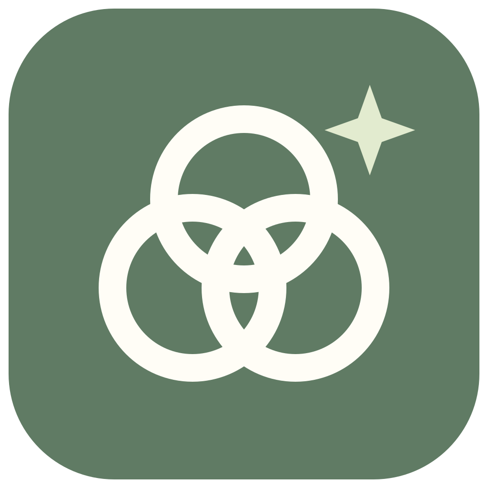
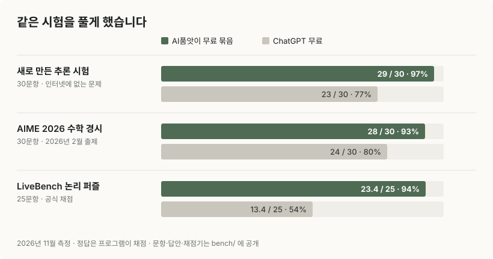
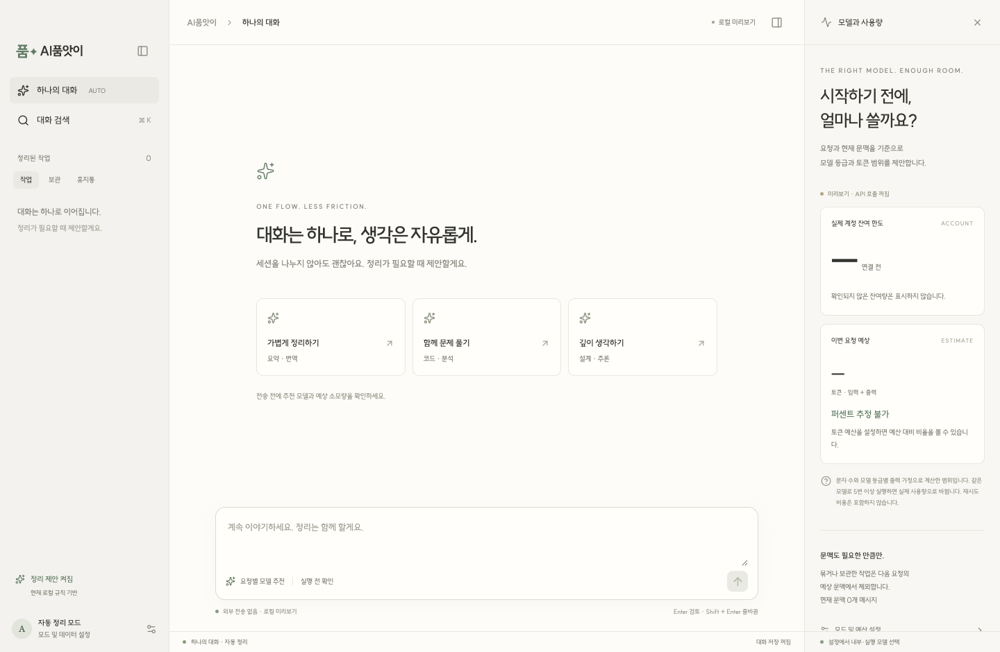

<h1>AI품앗이 · AI Pumasi</h1>

무료 AI 여럿이 품앗이하듯 함께 풀고, 투표로 답을 정하는 데스크톱 앱

품앗이: 서로 일을 거들어 주고받는 우리 옛 공동 노동. 0.1.8까지는 이름이 Aurora(오로라)였습니다.

<a href="https://ai-pumasi.vercel.app/">웹 데모</a> · <a href="#설치">다운로드</a> · <a href="docs/guide.md">사용 안내</a> · <a href="docs/components.md">구성 요소</a> · <a href="bench/README.md">측정 기록</a> · <a href="CHANGELOG.md">변경 기록</a> · <a href="README.en.md">English</a>

## AI품앗이가 잘하는 것

**무료 모델로도 ChatGPT 무료보다 잘 풉니다.** 매번 새로 만들어 인터넷에 없는 추론 시험 30문항에서 무료 모델 Nemotron Super는 30점, ChatGPT 무료는 23점을 받았습니다. 정답은 프로그램이 계산해 자동으로 채점합니다. 남이 낸 공개 시험도 같았습니다. 미국 수학 경시 AIME 2026에서 Super는 30문항 중 28개, ChatGPT 무료는 24개를 맞혔습니다. AI품앗이의 묶음 투표는 여러 무료 모델에 같은 질문을 던지고 측정한 실력만큼 무게를 줘서, 어느 모델이 잘하는지 몰라도 가장 잘하는 모델 수준의 답을 냅니다(외부 시험 55문항에서 묶음 51.4점, 단독 최고 51.0점). 여러 모델을 묶어 가장 잘하는 모델을 넘어서는 것은 아직 증명하지 못했고, 지금 그 실험을 하고 있습니다. 방법과 원자료는 [측정 기록](bench/README.md)에 모두 있습니다.

**비싼 모델에는 비싼 일만 맡깁니다.** 팀 모드에서 총괄 모델(예: Claude Opus)은 일을 작업 1~6개로 나누고 결과를 승인할지만 정합니다. 답을 다시 쓰지 않고, 합치는 일도 무료 작업 모델이 합니다. 그래서 가장 비싼 출력 토큰이 구조적으로 적게 나갑니다.

**무료 모델이 멈추거나 대충 답해도 알아서 다시 맡깁니다.** 빈 답, 너무 짧은 답, 중간에 잘린 답, 시간 초과는 실패로 보고 같은 모델에 한 번 더, 그래도 안 되면 다른 무료 모델에 넘깁니다. 자주 실패하거나 느린 모델은 기록해 두고 순서를 뒤로 보냅니다. 어느 작업이 몇 초째 걸리는지 실행 화면에서 바로 보입니다.

**쓰기 전에 얼마나 들지 보입니다.** 실행 전에 예상 토큰 범위와 정해 둔 예산 대비 비율을 보여 주고, 끝나면 총괄·작업 모델 사용량을 따로 표시합니다.

**코딩 도구가 아니라 누구나 쓰는 질문 앱입니다.** 파일이나 터미널 권한 없이 일반 질문과 문서 작업에 답합니다. 화면은 한국어와 영어로 볼 수 있습니다.

## 지금 되는 것

- OpenAI, Anthropic, Gemini, Ollama 모델에 텍스트 요청
- 팀 모드: 총괄 모델이 나누고, 작업 모델이 처리하고, 총괄 모델이 판정 (최대 2회차)
- 막힌 작업 다시 맡기기: 빈 답·잘린 답·시간 초과 재시도, 모델별 기록에 따른 순서 조정, 작업별 진행 표시
- 묶음 투표: 무료 모델 2~5개가 같은 질문을 풀고, 측정한 실력만큼 무게를 준 투표로 답을 고름 (서술형은 가장 강한 모델이 합침). 남은 모델이 모두 반대해도 결과가 뒤집히지 않으면 기다리지 않고 바로 확정
- 내 사용량으로 배우는 토큰 추정: 실제 쓴 토큰을 기기 안에 기록해 다음 요청이 예산의 몇 %를 쓸지 표시 (켜고 끄기)
- 무료 제공자 여러 곳 연결: NVIDIA·OpenRouter·Groq·Google 무료 키를 설정에 넣으면 그 무료 모델을 바로 씀. 같은 모델을 여러 곳이 주면 한도에 걸린 곳은 잠깐 쉬게 하고 다른 곳으로 자동으로 넘김
- 자동 (무료) 모델: 지금 쓸 수 있는 무료 모델 중 측정 성적이 가장 높은 것부터 쓰고, 막히면 다음 모델로 넘김
- OpenAI 호환 서버 직접 연결: 다른 OpenAI 호환 주소도 설정에 넣어 씀
- 설정에서 API 키 관리: OS 키체인으로 암호화해 저장하고, 화면·모델·기록 어디에도 다시 나오지 않음
- 응답 후 실제 사용량 표시
- 대화를 작업 단위로 묶기, 보관·휴지통·복원, 기기 내 저장(기본 꺼짐)
- macOS(서명·공증)·Windows x64 설치 파일, 자동 업데이트

## 다음에 오는 것

차례대로 만들어 버전마다 배포합니다.

1. **품앗이 게시판:** 문제를 올리면 내 앱이 일을 나눠 게시하고, 다른 사용자가 "돕기"를 누르면 그 사람의 앱이 자기 토큰으로 작업 하나를 자동으로 처리해 올립니다. 여러 사람의 결과는 투표로 고르고, 기부한 만큼 점수가 쌓입니다. [설계](docs/pumasi-network.md)
2. **스트리밍 응답:** 답이 다 만들어질 때까지 기다리지 않고 쓰는 대로 보입니다.
3. **실행 방식 자동 선택:** 질문을 보고 단일 모델·팀·묶음 투표 중 어떤 방식이 맞는지 골라 줍니다.
4. **파일 첨부:** 문서를 붙여 질문합니다.

## 이런 분께 맞습니다

코드를 고치고 터미널을 다루는 에이전트가 필요하면 [OpenCode](https://opencode.ai)나 [Roo Code](https://roocode.com)가 맞고, 수십 개 제공자와 지식 베이스가 필요하면 [Cherry Studio](https://github.com/CherryHQ/cherry-studio)나 [Open WebUI](https://github.com/open-webui/open-webui)가 맞습니다. AI품앗이는 유료 AI 하나에 모든 걸 맡기기엔 비싸고 무료 AI 하나로는 아쉬운 분, 그리고 무엇에 얼마가 드는지 보면서 쓰고 싶은 분을 위한 앱입니다. 지금은 개인이 만드는 개발 프리뷰입니다.

## 설치

| 운영체제 | 설치 파일 |
| --- | --- |
| macOS · Apple Silicon | [DMG](https://github.com/uiwwsw/ai-pumasi/releases/download/v0.1.9/AI-Pumasi-0.1.9-mac-arm64.dmg) |
| macOS · Intel | [DMG](https://github.com/uiwwsw/ai-pumasi/releases/download/v0.1.9/AI-Pumasi-0.1.9-mac-x64.dmg) |
| Windows · x64 | [EXE](https://github.com/uiwwsw/ai-pumasi/releases/download/v0.1.9/AI-Pumasi-0.1.9-windows-x64.exe) |

Windows 설치 파일은 개발자 인증서로 서명하지 않아 SmartScreen 경고가 나올 수 있습니다. 키 설정, 팀 모드 사용법, 데이터 처리, 소스에서 실행하는 방법은 [사용 안내](docs/guide.md)에 있습니다.

## 라이선스

[MIT](LICENSE). SUITE 글꼴은 [별도 라이선스](public/fonts/LICENSE)를 따릅니다. 쓴 라이브러리와 참고한 프로젝트는 [구성 요소](docs/components.md)에 있습니다.
